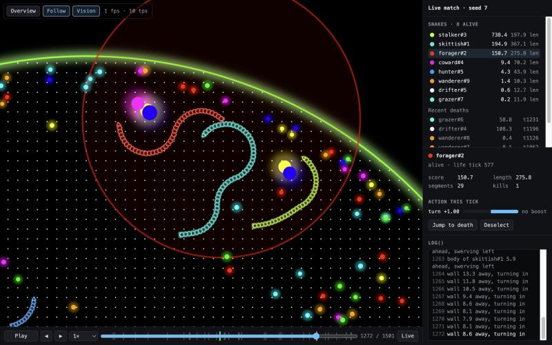

# @zerosnake/viewer

The match viewer used by `zerosnake sim` and later by the site: canvas, timeline, snake list and
a panel for the selected snake (stats, vision radius, current action, `log()` lines). Built on
`@zerosnake/renderer`, which stays engine-agnostic; this package is where engine data meets it.

```bash
pnpm --filter @zerosnake/viewer dev   # live match of demo bots, http://localhost:5173
```

`?seed=7` reproduces a match, `?select=hunter%231` starts with a snake selected.



## Embedding

```ts
import { LiveEngineSource, mountViewer } from "@zerosnake/viewer";

const source = new LiveEngineSource({ bots, seed: 42 });
const viewer = mountViewer(element, source, { select: "hunter#1", keyboard: "window" });

viewer.playback.seek(120);
viewer.select("forager#2");
viewer.destroy();
```

The viewer fills `element` (give it a height) and injects its own scoped styles, so it needs no
CSS import or particular bundler.

## Sources

The viewer only talks to a `MatchSource` (`src/types.ts`): `request(tick)` asks for ticks up to
the playhead, `snapshot(tick)` reads one back, `lives()` lists every life with its death, if
any. A source decides how ticks come to exist:

| Source                    | `request(tick)`                    | `endTick`    |
| ------------------------- | ---------------------------------- | ------------ |
| `LiveEngineSource` (here) | simulates up to `tick` in the page | `undefined`  |
| replay player (after #9)  | re-simulates from seed + actions   | end of chunk |
| room broadcast (later)    | no-op; ticks arrive by themselves  | `undefined`  |

A `TickSnapshot` holds a `RenderFrame` for the renderer and per-snake stats: score, mass,
kills, and the `action`, `logs` and `ops` of the bot call that saw that tick. A source may
leave out what it doesn't know.

`LiveEngineSource` runs `LiveBot`s (`act(snake, world, log) => Action`) against the engine,
respawns dead bots as new lives (`name#1`, `name#2`, …) and keeps every tick in memory for
scrubbing (`maxTicks`, default 30 minutes at 10 tps).

## Controls

| Key              | Action                                      |
| ---------------- | ------------------------------------------- |
| `Space`          | play / pause                                |
| `←` `→`          | one tick back / forward (`Shift`: 10)       |
| `[` `]`          | slower / faster (0.25× … 16×)               |
| `L`              | jump to the newest tick                     |
| `D`              | play the last 3 s before the selected death |
| `Tab` / `Esc`    | select next snake / deselect                |
| `F` / `O`        | follow the selected snake / whole arena     |
| `V`              | toggle the vision radius                    |
| wheel, `+` / `-` | zoom                                        |

Click a snake on the arena or in the list to select it. Keys listen on the focused viewer by
default; `keyboard: "window"` makes them global, `"off"` disables them.
